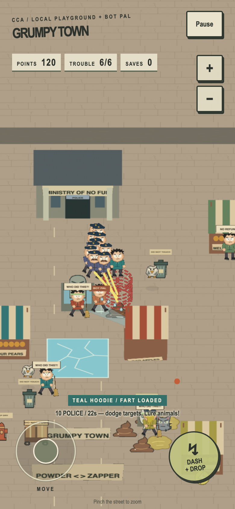

# Babylon local cutout trial

Implemented 15 November 2026 in [the SPA](../../apps/cca-2d/README.md), using pinned
Babylon.js 9.36.0. The local trial now includes the
[Grumpy Town interaction slice](grumpy-town.md) before multiplayer. Working scene
title: **Grumpy Town**.

## Actual gameplay

[Watch actual touch gameplay](visual-concepts/living-town-gameplay.webm).
The recording uses visible touch controls in a fresh Chromium context at
390 × 844 CSS pixels. Screenshots use device scale 2; render density is capped
at 1.5. These are rendered Babylon meshes and animated textures, not generated
concept art or a physical-device recording. There is no audio yet.

[Starting view](visual-concepts/living-town-phone.png) ·
[Bird poop and stained player](visual-concepts/living-town-bird.png) ·
[Dog pee](visual-concepts/living-town-dog.png) ·
[Cat puke](visual-concepts/living-town-cat.png) ·
[Tipping bin](visual-concepts/living-town-bin.png) ·
[Broken hydrant](visual-concepts/living-town-hydrant.png) ·
[Toilet overflow](visual-concepts/living-town-toilet.png) ·
[Bonus and dispatch](visual-concepts/living-town-bonus.png) ·
[Frozen](visual-concepts/living-town-frozen.png) ·
[Police returning](visual-concepts/living-town-return.png).
Earlier `grumpy-loop-*`, `grumpy-town-*` and `babylon-trial-*` captures preserve
superseded mechanics, including the former interruptible three-guard alarm.

## What to try on your phone

Run the commands in the app README and open its Network URL on the same Wi-Fi.
A local HTTP URL is sufficient for this offline WebGL trial. Later authenticated
Rallar testing uses the architecture's HTTPS deployment.

1. Dash into fruit. Its owner cleans while a tidy neighbour may chase. Dodge the
   marked zap or lose three points. Walking alone does not upset anyone.
2. Dash into the central fountain to redirect its jet. Try escaping through the
   spray while the apple owner repairs it. Release the parcel cart near the start
   and see the pear owner retrieve it.
3. Go south for powder or a zapper. Walk over a pickup, then use the same dash
   action near an owner. Powder causes dizziness/puke; zappers shrink NPCs.
4. Tip the two bins, spill fish, overflow the toilet and break the hydrant.
   Dodge bird poop, dog pee and cat puke; lure their attacks into grumps. Water
   washes stains off.
5. Make six fresh rewarded messes: earn +50, then use the five-second warning.
   Ten police leave the Ministry for 25 seconds. Dodge red targets, use cover or
   distract them with creature attacks. They stop attacking and return home.
6. A catch freezes for six seconds. Stand beside a frozen BOT PAL for one second
   to rescue; it attempts the same for you. This companion is local simulation.
7. Pinch or tap +/−, pause/reset, switch apps and return, then rotate your phone.

The immediate feedback to collect is control comfort, readable faces, dash/slide
feel and how much of the market you can see. This trial does not yet answer
whether complete competitive rounds are fun.

## How this reproduces the direction

Original human characters use separately drawn SVG head/torso/limb textures on
Babylon planes, hinged under TransformNodes. Four expressions cover grumpy, angry, surprised and dizzy poses.
Bodies lean, legs splay, brooms swing and cartoon puke appears briefly. The whole assembly faces the fixed camera
at a consistent tilt. Animation changes presentation only.

Stalls and government use simple boxes, striped awnings and paper colors. Ice and water
are ground quads. A reusable puff plane grows and fades. Texture grain is authored
in the SVG source. No external art tool, physics engine, 3D character rig or
multiplayer server is needed to reproduce this scene.

The six owners, six creatures and ten temporary police are driven by immutable rules.
Displays tip, fruit rolls, water sweeps, a cart moves, warning targets mark attacks,
and cleanup repairs the square. Ice overlays, countdowns, labels and work bars
communicate danger and recovery. Stalls keep their collision footprints while
tipped. The Ministry doorway is the police departure/return point; outer buildings
remain scenery. Creature cutouts use authored SVG art; droplets, streams, stains
and ground mess display simulation state. Collection/banking, timed
winners, other human players and a complete match objective are not implemented.

## Reliability and loading evidence

The immutable rules run at a fixed 60 Hz with a bounded frame catch-up. Input
cancellation clears movement; backgrounding pauses; resuming consumes stale action
edges. Obstacles stop dashes. A cooldown press is discarded, never queued.

Forty-eight CCA rule tests and nine visible-control browser tests pass. They cover
stall damage, slipping, chase/score penalties, bounded raids, freeze/rescue,
collision-clear routes, cleanup/repair, creature attacks/dodges, collateral credit,
washing, obstruction, effect expiry and temporary pranks,
simultaneous touch movement/dash, pinch, keyboard, responsive dimensions and
pause/reset. These tests establish local behavior, not physical-device performance.

The production build lazy-loads the Babylon scene. The main game/engine chunk is
about 240 kB gzip; other engine/shader chunks are separate. That figure alone is
not a cold-transfer measurement. The old approximately 2 MiB generated WebP seed
art and Phaser dependency are removed from this entry. All current visual textures
are generated locally from the shipped source. Vite reports its large uncompressed
chunk warning; the build passes.

Physical iPhone/iPad Safari, ten-minute heat/frame pacing, cold mobile-network
loading and repeated-remount GPU allocation remain unverified. No multiplayer,
host-recovery or production-release claim follows from these local tests.

## Next decision

Try this scene and judge whether different messes create useful escape choices,
whether warnings are readable, and whether six seconds frozen is funny or tedious.
The bot proves mechanics, not the fun of rescuing real friends. No round timer,
qualification target or winner screen is implemented yet.

The current slice collects physical phone feedback and tunes the local loop.
Rallar-only player-hosted multiplayer follows, with explicit recovery behaviour.
Keep the historical separate CCA server outside this app.
