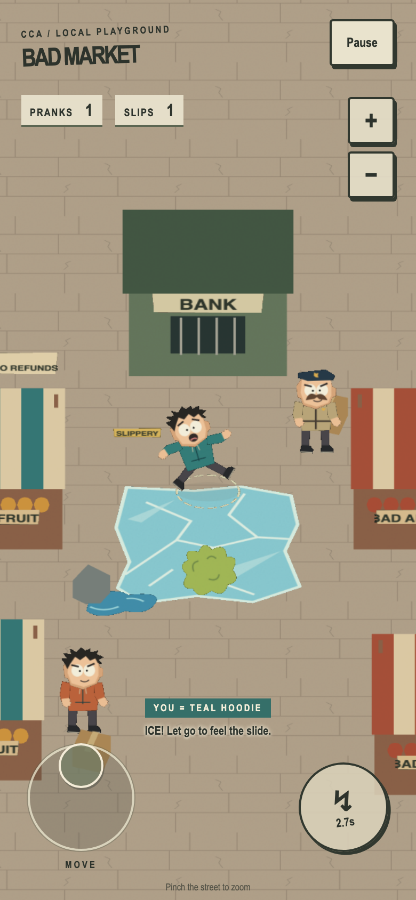

# Babylon local cutout trial

Implemented 15 November 2026 in [the SPA](../../apps/cca-2d/README.md), using pinned
Babylon.js 9.36.0. This is the requested movement / dash-and-drop / slipping / zoom
trial before multiplayer. Working scene title: **Bad Market**.

## Actual gameplay

[Watch the actual gameplay recording](visual-concepts/babylon-trial-gameplay.webm).
The recording uses visible controls in a fresh Chromium context at 390 × 844 CSS
pixels. The screenshot is captured at device scale 2; the renderer caps density
at 1.5. These are rendered Babylon meshes and animated textures, not generated
concept art and not a physical-device recording.

[Starting view](visual-concepts/babylon-trial-phone.png) shows the resting scene.
The recording demonstrates simultaneous joystick/dash input, sliding, zoom,
movement and reset. It has no audio.

## What to try on your phone

Run the commands in the app README and open its Network URL on the same Wi-Fi.
A local HTTP URL is sufficient for this offline WebGL trial. Later authenticated
Rallar testing uses the architecture's HTTPS deployment.

1. Drag the left joystick toward the cyan ice. Release it and feel the slide.
2. Press **DASH + DROP** while moving. One cloud stays at departure while you dash.
3. Turn on the ice; try to recover without hitting a stall.
4. Pinch the street or tap +/−. Movement speed stays independent of zoom.
5. Pause/reset, switch apps and return, then rotate the phone.

The immediate feedback to collect is control comfort, readable faces, dash/slide
feel and how much of the market you can see. This trial does not yet answer
whether complete competitive rounds are fun.

## How this reproduces the direction

Original human characters use separately drawn SVG head/torso/limb textures on
Babylon planes, hinged under TransformNodes. Two expression textures switch on
slipping; the body leans and legs splay. The whole assembly faces the fixed camera
at a consistent tilt. Animation changes presentation only.

Stalls and bank use simple boxes, striped awnings and paper colors. Ice and water
are ground quads. A reusable puff plane grows and fades. Texture grain is authored
in the SVG source. No external art tool, physics engine, 3D character rig or
multiplayer server is needed to reproduce this scene.

Compared with the generated target, this trial deliberately has smaller actors,
simpler scenery, fewer props and less grain. The guard and rival are stationary
stand-ins; the guard reacts cosmetically to a nearby cloud. Pursuit, rival tactics,
collecting, banking, falling collisions and timed winners are not implemented.

## Reliability and loading evidence

The immutable rules run at a fixed 60 Hz with a bounded frame catch-up. Input
cancellation clears movement; backgrounding pauses; resuming consumes stale action
edges. Obstacles stop dashes. A cooldown press is discarded, never queued.

Five rule tests and four visible-control browser tests pass. Browser tests include
simultaneous touch movement/dash and two-finger pinch, keyboard actions, responsive
phone/tablet/landscape dimensions, pause/reset and Space activation of focused
buttons. A fresh static review found the focused-button bug; its regression test
failed before the fix and passed afterward.

The production build lazy-loads the Babylon scene. The main game/engine chunk is
about 226 kB gzip; other engine/shader chunks are separate. That figure alone is
not a cold-transfer measurement. The old approximately 2 MiB generated WebP seed
art and Phaser dependency are removed from this entry. All current visual textures
are generated locally from the shipped source. Vite reports its large uncompressed
chunk warning; the build passes.

Physical iPhone/iPad Safari, ten-minute heat/frame pacing, cold mobile-network
loading and repeated-remount GPU allocation remain unverified. No multiplayer,
host-recovery or production-release claim follows from these local tests.

## Next decision

Try this scene and decide whether its proportions, cutout expression and control
feel are worth taking forward. Refine from that playtest before expanding content.
The following implementation slice remains Rallar-only player-hosted multiplayer
with explicit recovery behavior. Do not connect the historical separate CCA server
to this entry as a shortcut.
