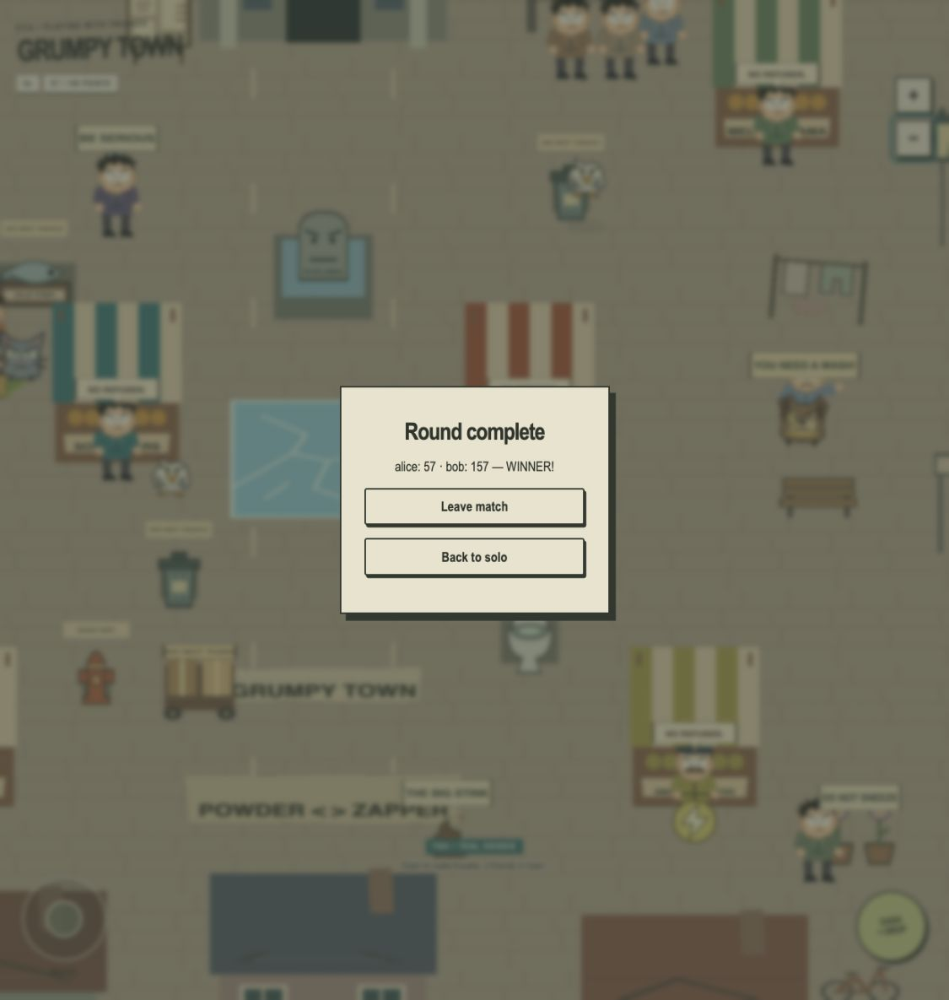
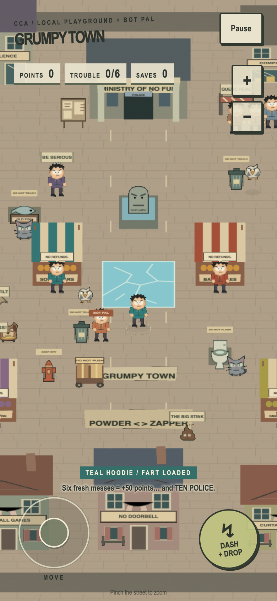

# Babylon local cutout trial

Implemented 15 November 2026 in [the SPA](../../apps/cca-2d/README.md), using pinned
Babylon.js 9.36.0. The local trial now includes the
[Grumpy Town interaction slice](grumpy-town.md) before multiplayer. Working scene
title: **Grumpy Town**. The sections below the physical-device report preserve
the original solo trial; their original limitations do not describe the later
multiplayer implementation.

## Responsiveness correction — 16 November 2026

The online renderer now predicts the local player's movement and dash using the
same movement, slipping and obstacle rules as the host. It keeps at most 300 ms
of visual lead over the latest confirmed player state, rebases on each new
checkpoint and replays only the newer local presentation interval. This interval
is aligned by simulation elapsed time, not by subtracting device wall clocks.
It is a visual estimate, not an input acknowledgement. During a long delay it
stops advancing rather than inventing a continuing match.

The town, interactions, points, peer positions and results still come from
confirmed checkpoints. A local dash/cloud may be corrected if the host rejects
it. A confirmed freeze cannot be released by prediction. Recovery, observer
mode, new rounds and authority changes discard the prediction; round-end
transitions render the confirmed final pose. No wire format, checkpoint frequency,
acknowledgement requirement or Rallar package behavior changes in this correction.

**Host match** now follows Rallar's existing appointment eligibility policy and
is disabled while appointment is pending. Manual and automatic appointments share
one error lifecycle: a fresh host clears an obsolete appointment failure, while
unrelated transport/validation failures remain visible. Browser coverage includes
a guest failing to host while the owner is absent, followed by the returning owner
hosting successfully and the guest receiving a healthy Ready/status display.
Creating a new town also cancels the previous room-entry destination and failure;
a refused old matched-town entry must not remain as an error over a successful
new lobby. This additional issue was reproduced while preparing the phone retest.

### Response measurement

The browser test records `performance.now()` at the actual key/pointer event,
then observes the rendered player and the confirmed player each animation frame.
The confirmed-state timing represents the old renderer's wait in the same trial;
it is not a separate measurement of an old executable. Movement is measured from
rest and dash by its action counter, avoiding the earlier sliding/click-tool
timing ambiguity. Diagnostics for confirmed state remain separate from rendered
state. Raw run artifacts are under ignored `tmp/perf/cca-clean-responsiveness/`.

Two clean-candidate desktop Chromium trials, each with a host and guest, recorded:

| Event-to-observed-state metric | Confirmed state (old display path) | Local presentation | Samples |
| --- | ---: | ---: | ---: |
| Movement median | 364.5 ms | 3.6 ms | 4 |
| Dash median | 417.0 ms | 6.0 ms | 4 |

Movement presentation ranged from 3.4–45.1 ms; dash presentation ranged from
5.8–6.3 ms. This confirms removal of the checkpoint wait from the local visual
path in this small desktop workload, not a general latency guarantee. The tests
used real local Rallar services, normal device clocks and Chromium's software
WebGL configuration. Deferred AL-builder edits were excluded and then restored.
CPU/GPU, allocation and physical display-scanout costs were not profiled.

Final validation is recorded in PR #832. These tests do not establish touch
latency or sustained frame pacing on a physical iPhone. The first measurement
harness missed an event before its listener was
armed; it now waits for listener readiness. A later run was invalidated by a
development-server reload during editing and was discarded.

The publishable candidate passed 138 game tests, the app typecheck/production
build, and nine real-service browser checks: the three new scenarios repeated
twice, independent two-player controls, silent host-loss recovery, and the real
three-minute fruit-prank round with shared results and a clean rematch. The unit
command used `--testTimeout=15000` because the existing long police-wave simulation
exceeded its five-second budget; assertions and simulated duration were unchanged.
Build chunk-size warnings remain. Independent review covered every changed code
and test file; no remaining correctness blocker or retained legacy exception was
identified. Physical-phone acceptance is still pending.

### Next two useful slices

1. Retest the HTTPS build on Bob's iPhone with Alice in the desktop browser.
   Compare immediate movement, releasing movement, dash, sliding and corrections
   near stalls; finish a round and rematch. Compare phone-host and desktop-host
   behavior if lag remains. Record phone model/browser and local render cadence.
2. Use that feedback to tune correction behavior and peer presentation. Peer
   interpolation and snapshot/serialization profiling remain follow-up work;
   do not change authoritative scoring or weaken recovery to hide a visual delay.

The original physical trial below describes the committed-only renderer before
this correction. The PR remains draft until phone responsiveness is accepted.

## Physical two-player trial — 16 November 2026

Tested the HTTPS LAN build on port 5184 at revision `74e87470b`, with Bob hosting
on a physical iPhone and Alice joining through the Codex in-app browser on the
development computer. The phone's exact model, iOS version and render frame rate
were not captured. Deferred AL-builder edits were present in the local working
tree; this is local device evidence, not qualification of the clean PR revision.

**Functional result:** the full three-minute round completed without an observed
disconnect. Alice received Bob's movement, sent her own keyboard movement and
three accepted dashes, zoomed, and earned points. Alice's result screen showed
Bob at 120 points (winner) and Alice at 60. The user confirmed the phone reached
the end and restarted, but missed its exact scores. A new match ID and a running
second round were observed on Alice, confirming rematch propagation. That round
also completed: Alice's screen showed Bob at 157 points and Alice at 57, and the
user confirmed those numbers on the phone. The user also confirmed both players
were visible on the phone. Alice's browser reported
no captured console warnings or errors at the end; the earlier appointment
rejection was rendered in the lobby rather than logged to the console.

This capture is Alice's in-app browser, not a recording of the iPhone display.

**Responsiveness result: not accepted.** The user reported movement or dash lag
on the iPhone. Receiving state and finishing a round do not establish a good
game experience.

### Measurements and limits

Read-only sampling of Alice's rendered DOM diagnostics during the rematch
recorded 150 observations over 4.988 seconds. The simulation advanced 146 ticks
(about 29.3 ticks/second). There were 31 observed state changes; the 30 intervals
between them had a median gap of 122 ms and a maximum gap of 244 ms. The initial
sample-to-first-change wait was 306 ms and is excluded from those intervals.
Browser reads took a median 21 ms, with
10 ms requested between reads; this samples visible update cadence, not the
phone's frame rate or raw network latency. An earlier 5.845-second sample showed
176 ticks of simulation progress, providing a second near-30-Hz observation.

Three further dash presses were accepted. Their automated action-to-observation
times were 271–372 ms, but the click tool itself occupied about 268 ms, so those
values cannot establish actual touch latency. Short alternating movement probes
were also inconclusive because residual sliding could move the character before
the newly requested direction took effect. Do not quote either as a measured
phone input latency.

Raw local observations are under ignored `tmp/perf/cca-iphone-host-*.json`.
The first finer-cadence attempt ran after the round finished and is not a
gameplay performance sample. No CPU/GPU profile, allocation measurement or
phone touch-to-frame measurement was collected.

### Original diagnosis and proposed slices

**Proven from the trial revision's code:** `TownMatchSession.advance` samples controls at 50 ms and
exchanges checkpoints at 100 ms. `TownMatchSession.getView` exposes committed
checkpoint state, and `TownMatchGame.frame` renders that state for the local
player as well as peers. Even the phone host waits for checkpoint confirmation
before displaying its simulated movement. This adds confirmation delay to the
visible control path. The observation of near-30-Hz simulation with substantially
less frequent displayed state supports investigating this path first; it does
not rule out phone rendering cost or network scheduling.

1. Measure input sampling, host acceptance, checkpoint confirmation and visible
   presentation separately using monotonic clocks on each device. Capture phone
   render cadence and snapshot payload/serialization cost. Compare phone-host
   and desktop-host runs, plus offline solo, without subtracting unsynchronized
   device clocks. Preserve the current completed-round baseline and recovery
   tests. A smoother solo run alone does not identify the exact multiplayer cost.
2. Based on that trace, make the smallest presentation change that removes
   confirmed input delay: assess local movement prediction/reconciliation and
   peer interpolation, while keeping points, hits, hazards, winners and recovery
   checkpoints authoritative. Do not merely increase full-checkpoint traffic or
   weaken acknowledgments. Require measured before/after response, a full round,
   rematch and host-loss regression checks before accepting the change.

The trial also exposed a lobby issue: a non-owner was offered **Host match** while
an owner was online. Rallar correctly rejected it, but the raw rejection remained
visible after the owner hosted and Ready succeeded. The correction above uses the
existing director-appointment eligibility policy and clears superseded appointment
errors. No Rallar authorization policy change was needed.

## Actual gameplay

[Watch actual touch gameplay](visual-concepts/town-square-touch-gameplay.webm) (75-second excerpt) · [bell interaction](visual-concepts/town-square-bell-gameplay.webm).
The recording uses the visible joystick and simultaneous dash button in a fresh
Chromium context at 390 × 844 CSS pixels. Screenshots use device scale 2;
render density is capped at 1.5. These are rendered Babylon meshes and animated
textures, not generated concept art or a physical-device recording. There is no audio yet.

[Bomb warning](visual-concepts/town-square-bomb-warning.png) ·
[Big Stink splash](visual-concepts/town-square-bomb.png) ·
[Fire crew](visual-concepts/town-square-fire.png) ·
[Fire cleanup](visual-concepts/town-square-fire-cleanup.png) ·
[Café spectacle](visual-concepts/town-square-cafe.png) ·
[Umbrella](visual-concepts/town-square-umbrella.png) ·
[Tiny bucket](visual-concepts/town-square-tiny-bucket.png) ·
[Bell reaction](visual-concepts/town-square-bell.png) ·
[Tablet](visual-concepts/town-square-tablet.png) ·
[Desktop](visual-concepts/town-square-desktop.png).

The earlier [ten-police recording](visual-concepts/living-town-gameplay.webm)
and `living-town-*` stills show the preceding layout. Older `grumpy-loop-*`,
`grumpy-town-*` and `babylon-trial-*` captures preserve superseded mechanics.

## What to try on your phone

Run the commands in the app README and open its Network URL on the same Wi-Fi.
A local HTTP URL is sufficient for this offline WebGL trial. Later authenticated
Rallar testing uses the architecture's HTTPS deployment.

1. Dash into fruit. Its owner cleans while a tidy neighbour may chase. Dodge the
   marked zap or lose three points. Walking alone does not upset anyone.
2. Dash into the central fountain to redirect its jet. Try escaping through the
   spray while the apple owner repairs it. Release the parcel cart near the start
   and see the pear owner retrieve it.
3. Go south for powder or a zapper. Walk over a pickup, then use the same dash
   action near an owner. Powder causes dizziness/puke; zappers shrink NPCs.
4. Tip the two bins, spill fish, overflow the toilet and break the hydrant.
   Dodge bird poop, dog pee and cat puke; lure their attacks into grumps. Water
   washes stains off.
5. Make six fresh rewarded messes: earn +50, then use the five-second warning.
   Ten police leave the Ministry for 25 seconds. Dodge red targets, use cover or
   distract them with creature attacks. They stop attacking and return home.
6. A catch freezes for six seconds. Stand beside a frozen BOT PAL for one second
   to rescue; it attempts the same for you. This companion is local simulation.
7. Explore the west street: ring **NO NOISE**, disturb **FREE SAMPLES**, kick the
   barbecue marked **DO NOT KICK**, or trigger the vacuum. Watch witnesses react
   and the fire crew travel, warn, extinguish and return. Step into water to wash.
8. Collect **THE BIG STINK** south of the starting square. Dash to drop it, then
   escape the marked radius or take cover. At the café, dash the umbrella during
   the inspector's stream and watch the waiter save the cake.
9. Try the gardener in the southeast, laundry in the east, queue in the north and
   mayor's statue northwest of the fountain. Every personality recovers; repeated
   hits do not farm its reward.
10. Pinch or tap +/−, pause/reset, switch apps and return, then rotate your phone.

The immediate feedback to collect is control comfort, readable faces, dash/slide
feel and how much of the market you can see. This trial does not yet answer
whether complete competitive rounds are fun.

## How this reproduces the direction

Original human characters use separately drawn SVG head/torso/limb textures on
Babylon planes, hinged under TransformNodes. Four expressions cover grumpy, angry, surprised and dizzy poses.
Bodies lean, legs splay, brooms swing and cartoon puke appears briefly. The whole assembly faces the fixed camera
at a consistent tilt. Animation changes presentation only.

Stalls and civic/shop/house facades use simple boxes, varied heights, gables, striped awnings and paper colors. Ice and water
are ground quads. A reusable puff plane grows and fades. Texture grain is authored
in the SVG source. No external art tool, physics engine, 3D character rig or
multiplayer server is needed to reproduce this scene.

Six shop owners, eight additional personalities, six creatures, two responding firefighters and ten temporary police are driven by immutable match-state rules. An app-owned routing service memoizes derived geometry outside that state.
Displays tip, fruit rolls, water sweeps, a cart moves, warning targets mark attacks,
and cleanup repairs the square. Ice overlays, countdowns, labels and work bars
communicate danger and recovery. Stalls keep their collision footprints while
tipped. The Ministry doorway is the police departure/return point; outer buildings and furniture now have solid footprints and participate in sight/travel. Their doors are scenery; indoor gameplay is not implemented. Creature cutouts use authored SVG art; droplets, streams, stains
and ground mess display simulation state. Collection/banking, timed
winners, other human players and a complete match objective are not implemented.

## Reliability and loading evidence

The match-state rules run at a fixed 60 Hz with a bounded frame catch-up. Input
cancellation clears movement; backgrounding pauses; resuming consumes stale action
edges. Obstacles stop dashes. A cooldown press is discarded, never queued.

Sixty-six CCA rule tests pass. Twelve visible-control browser tests cover the expanded trial. They cover
stall damage, slipping, chase/score penalties, bounded raids, freeze/rescue,
collision-clear routes, cleanup/repair, creature attacks/dodges, collateral credit,
washing, obstruction, effect expiry, temporary pranks, personality reactions, route-cache lifecycle, spectacle queue/rewards, crew warning/extinguishing/return and umbrella deflection,
simultaneous touch movement/dash, pinch, keyboard, responsive dimensions and
pause/reset. These tests establish local behavior, not physical-device performance.

The larger square exposed repeated route computation. CPU profiling confirmed
route/sight calculations dominated the synthetic police-wave workload. Exact-key
destination reuse reduced that measured 3,600-tick workload from approximately
6.1 to 4.6 seconds on the development machine before final content tuning. This
is a local CPU observation, not a phone frame-rate or network performance claim.
The app owns one bounded cache, clears it on reset/stop and passes it explicitly
to rule evaluation. Independent owners produce identical simulation snapshots.

The production build lazy-loads the Babylon scene. The main game/engine chunk is
about 253 kB gzip; other engine/shader chunks are separate. That figure alone is
not a cold-transfer measurement. The old approximately 2 MiB generated WebP seed
art and Phaser dependency are removed from this entry. All current visual textures
are generated locally from the shipped source. Vite reports its large uncompressed
chunk warning; the build passes.

Physical iPhone/iPad Safari, ten-minute heat/frame pacing, cold mobile-network
loading and repeated-remount GPU allocation remain unverified. No multiplayer,
host-recovery or production-release claim follows from these local tests.

## Next decision

Try this scene and judge whether different messes create useful escape choices,
whether warnings are readable, and whether six seconds frozen is funny or tedious.
The bot proves mechanics, not the fun of rescuing real friends. No round timer,
qualification target or winner screen is implemented yet.

The current slice collects physical phone feedback and tunes the local loop.
Rallar-only player-hosted multiplayer follows, with explicit recovery behaviour.
Keep the historical separate CCA server outside this app.
