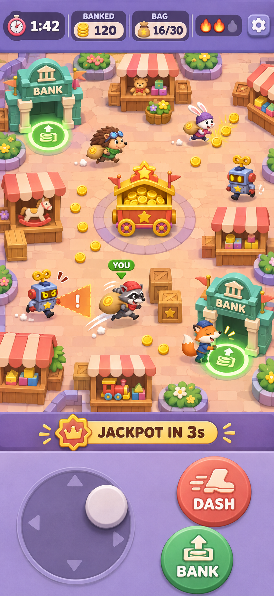

# Smartphone gameplay visual concepts

Generated with the built-in Imagegen tool on 15 November 2026 for graphics-style
selection. These are generated gameplay-screen mockups, not captures of an
implemented game, qualified touch layouts, or shipped sprite assets. None is selected yet.

All three depict the same kind of active four-player match: market obstacles,
two banks, a jackpot, token trails, guards, a local runner carrying loot, timer and
scores, and a reserved joystick/Dash/Bank control area. The requested layout was a
390 × 844 CSS-pixel portrait screen with a square world frame. The generated images
approximate the proportions and do not establish exact layout compliance.

The numbers below match the order the images were displayed in the design chat.
Use these files as the stable identity when selecting or refining a direction.

## 1. Paper Market Caper

Layered paper, ink outlines, warm textured ground, and cutout characters. This
explores the project pack's initial visual proposal.

## 2. Pocket Arcade Market

Deliberate pixel clusters, warm seaside-market tiles, bold sprite silhouettes,
and a compact arcade interface. The scenic horizon in this generated image is
not part of the proposed playable camera; remove it in a production translation.

## 3. Toybox Heist

Rounded toy figures, pastel surfaces, and soft baked shadows. If selected, develop
these as 2D sprite assets; the image does not select a 3D game engine.

## Selection and production boundaries

Choose the art language first, then revise the chosen screen into an exact layout
reference. Each generation makes the world taller than the specified square and
uses somewhat angled scenery. Preserve the common world visibility and orthogonal
navigation from [mobile and controls](../mobile-and-controls.md), and test camera,
occlusion, and character scale rather than copying those deviations.

The bank prompt, joystick and action sizes, safe areas, typography, and minimum
playfield must be measured at actual phone scale in implementation. The jackpot
presentation also needs refinement: a countdown should not appear over a visibly
collectible open jackpot. No visible mockup state overrides the game rules.

Do not crop these complete screenshots into production assets. Create an approved
character seed, consistent animation strips, environment tiles, and separate UI
components through the [art production workflow](../art-and-polish.md). Generated
static images do not prove animation quality, collision readability, download size,
or game performance. Their full prompts are recorded in [prompts](prompts.md).
