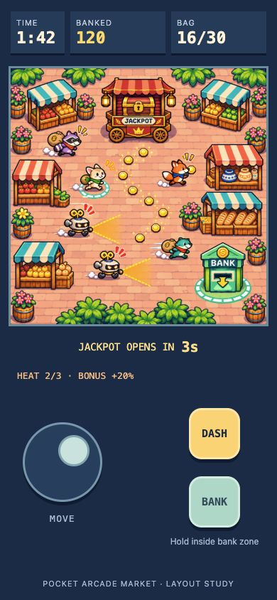
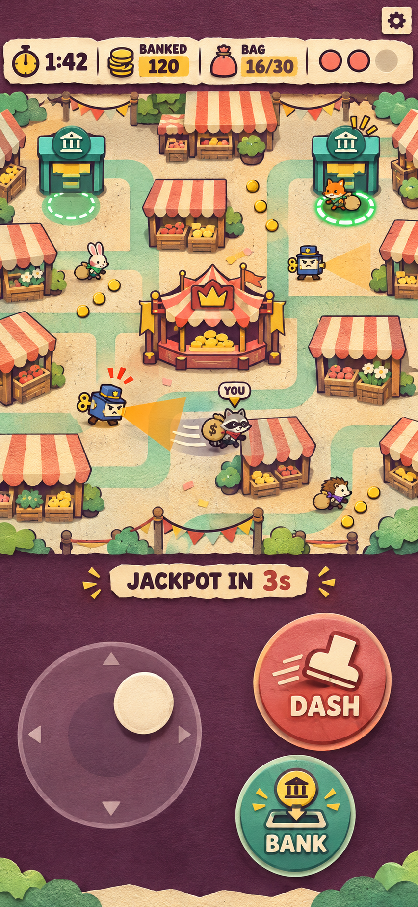
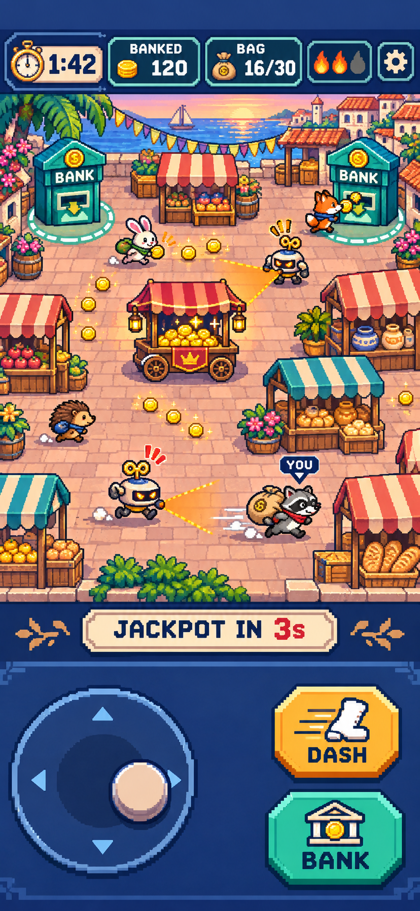

# Smartphone gameplay visual direction

**Selected: option 2, Pocket Arcade Market**, by the user on 15 November 2026.
Warm pixel art, navy outlines, peach paving, teal banks and gold loot are the
baseline for CCA 2D. The original three options remain below for context.

## Refined square phone composition

This is a browser capture of a **static layout reference**, using generated arena
art. It is not a capture of an implemented game. Open the
[HTML measurement fixture](pocket-arcade-layout.html) to inspect the composition.
It has a fixed 390 × 844 CSS-pixel app-content frame, without device/browser chrome.

- Playfield: **360 × 360**, at x=15, y=96; no scenic horizon or stretched world.
- Movement pad: **112px** diameter, with a **44px** thumb puck.
- Dash and Bank: **72 × 72px** target references, with **24px** clear separation.
- Controls sit entirely below the playfield; the lower area reserves thumb space.
- Jackpot stays closed while the HUD says it opens in three seconds.

The screenshot was measured from rendered DOM bounds, not estimated from image
proportions. The HTML intentionally contains no game loop or working controls.
Use [mobile and controls](../mobile-and-controls.md#selected-portrait-reference)
for coordinates, safe-area handling and adaptation to other screen sizes.

### What this approves and what still needs production work

The user selected the art direction. The refined composition supplies a concrete
translation target; it does not approve production sprites or certify gameplay.
The [arena illustration](pocket-arcade-arena-reference.png) provides mood, palette,
silhouettes and prop language. It is not a runtime background, tile atlas, exact
map, collision contract or true pixel-grid sprite sheet. Its visible bank can be
one part of the larger two-bank arena; the common camera does not show the full map.

Production must simplify tiny scenery, normalize pixel clusters, make target-only
guard recognition unmistakable, and qualify character sizes in motion. Guard
wedges are illustrative and do not change catch rules. The static Bank label and
closed jackpot illustrate state intent; actual eligibility, cooldown and deposit
progress must come from game state. The menu is omitted from this composition;
production retains an accessible menu target outside the playfield.

The reference's HUD values describe one moment. No static image proves animation,
multitouch, multiplayer, performance, physical thumb reach or fairness. Use the
[art production workflow](../art-and-polish.md) and retain the first moving scene
as the quality baseline before expanding assets. Do not crop complete screenshots
into production sprites. Generation provenance is in [prompts](prompts.md).

## Original alternatives

These original generated mockups approximate a 390 × 844 portrait screen. Their
world frames are too tall and controls are not measurement evidence. The refined
reference above supersedes their layout. Numbers match display order in the chat.

### 1. Paper Market Caper — not selected

Layered paper, ink outlines and cutout characters. This was the pack's initial
proposal; its paper textures and plum outlines are superseded by option 2.

### 2. Pocket Arcade Market — selected

Warm handheld arcade character, bold silhouettes and market tiles. Preserve that
identity; the scenic horizon, oversized layout and open-jackpot/countdown mismatch
in this original are superseded by the refined reference.

### 3. Toybox Heist — not selected

Rounded toy figures and soft baked shadows. This remains an alternative only;
do not mix its smooth toy rendering into the selected pixel-art asset family.
