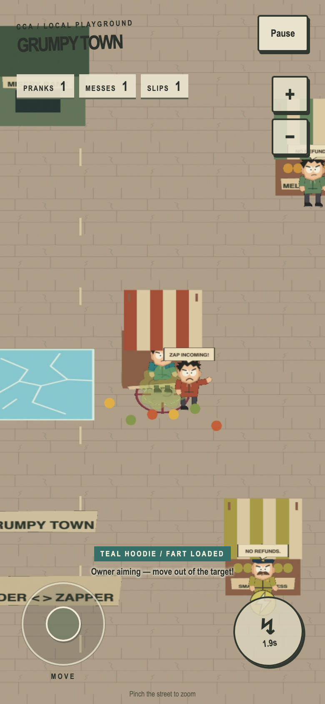
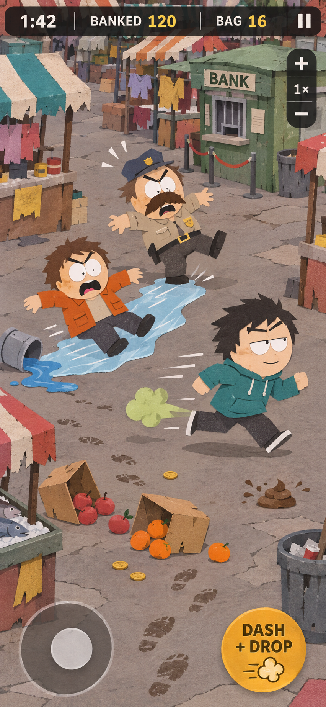

# Smartphone gameplay visual direction

## Actual Babylon trial

[Touch gameplay recording](grumpy-town-gameplay.webm) · [Starting view](grumpy-town-phone.png) ·
[Mini player and cleanup](grumpy-town-mini-cleanup.png) · [Powder](grumpy-town-powder.png).
These are actual Chromium gameplay captures of the local Babylon 9.36.0 scene,
using a 390 × 844 phone viewport. They are not physical-phone captures.
See [implemented scope, controls and limits](../babylon-local-trial.md).

## Generated reference: cutout market in Babylon 2.5D

Created with the built-in image-generation tool on 15 November 2026. The user
selected the Babylon 2.5D trial and South Park-like cutout direction. This particular
image awaits visual judgement; it is **generated concept imagery, not a Babylon
capture or a tested layout**.

The reference shows original human cutout characters, a fart-powered dash,
a rival sliding across water/ice and a furious falling guard. Floating movement
and DASH + DROP controls occupy the bottom quarter, with a compact HUD and zoom.
The market continues beyond the screen.

Use [Babylon scene construction](../babylon-scene-construction.md) for the
geometry/material/animation recipe and rendered proof gate. The exaggerated
character scale and dense paper grain are close-up style cues; simplify and
reframe for useful normal-play warning distance. The painted control dimensions,
shadows, bank position and apparent perspective are not exact implementation facts.

[Prompt and provenance](cutout-market-prompt.md) records the complete generation
brief. Keep this large image in the project documents; it is not a runtime asset.
[Art and polish](../art-and-polish.md) owns asset production;
[mobile and controls](../mobile-and-controls.md) owns real responsive UI dimensions.

## Historical practice and alternatives

The following artifacts preserve the earlier design exploration. None overrides
the current cutout, scrolling-camera or player-host architecture.

| Artifact                                                | What it actually shows                                                    |
| ------------------------------------------------------- | ------------------------------------------------------------------------- |
| [First playable phone](first-playable-phone.png)        | Actual Phaser practice capture, square world and 25% control deck         |
| [Refined Pocket Arcade](pocket-arcade-refined.jpg)      | Static browser layout capture at 390 × 844, not gameplay                  |
| [Layout fixture](pocket-arcade-layout.html)             | Historical measured square layout with separate Dash and Bank controls    |
| [Arena illustration](pocket-arcade-arena-reference.png) | Generated pixel-art scenery, not a collision map or sprite atlas          |
| [Paper Market Caper](paper-market-caper.png)            | Original paper-style alternative, not the current cutout production brief |
| [Pocket Arcade Market](pocket-arcade-market.png)        | Previously selected animal pixel-art alternative, now superseded          |
| [Toybox Heist](toybox-heist.png)                        | Original toy-like alternative                                             |
| [Historical prompts](prompts.md)                        | Original prompts, retained as provenance rather than active requirements  |

No still image proves animation, multitouch, multiplayer, load time, frame pacing
or host recovery. New progress must include actual Babylon gameplay captures.
